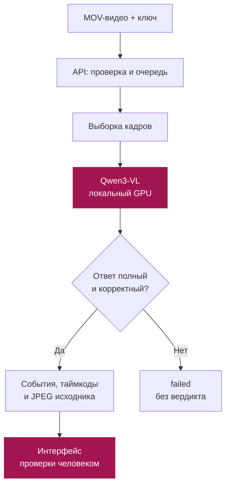

<div align="center">

# AI GYRLAR · Видеоаудит

### Из кассовой записи — в события, таймкоды и кадры для проверки.

Конкурсный прототип для кейса **ForteBank** · **DATATHON 2026**


**[Открыть демо][demo] · [Исходный код][source] · [API](#api) · [Результаты](#results) · [Запуск](#setup)**

</div>

---

## Что мы делаем

Просмотр кассового видео требует сопоставлять действия людей, предметы и последовательность событий. **AI GYRLAR** помогает организовать эту проверку: принимает запись, анализирует выбранные кадры с помощью визуально-языковой модели и возвращает отмеченные моменты с описанием и изображениями из того же видео.

**Сценарий работы:** загрузить запись → дождаться обработки → открыть событие → сверить таймкод и кадр → принять решение.

Это инструмент поддержки специалиста. Обнаруженное моделью событие требует проверки человеком; отсутствие срабатываний не подтверждает соблюдение всех правил.

> **О репозитории.** Здесь опубликован актуальный снимок реализации: API, интерфейс, Explainable AI, тесты, конфигурация рабочего Qwen и отчёты. Обученные QLoRA-адаптеры находятся в [Releases](https://github.com/Erzhigit07/AI-GYRLAR_DATATHON_FINAL/releases/tag/models-20261018). Приватные конкурсные записи, кадры и ключи не публикуются.

<a id="demo"></a>
## Демо для жюри

| Ресурс | Адрес / способ доступа |
| :--- | :--- |
| Веб-интерфейс | [Открыть видеоаудит][demo] |
| API base URL | `https://greatest-leu-responses-dictionaries.trycloudflare.com` |
| Проверка готовности | [`GET /healthz`][health] |
| Авторизация | Ключ команды: поле входа в интерфейсе или заголовок `X-API-Key` |
| Версия исходников | Актуальный снимок в ветке [`main`][source]; история исходного проекта сохранена в документации |

Ключ передаётся жюри отдельно и не публикуется в репозитории.

Адрес демо временный: доступ зависит от работающего ноутбука, сервиса и HTTPS-туннеля. Перед загрузкой проверьте `model_ready: true` в ответе `/healthz`. Если значение `false`, модель ещё не готова к обработке — открывающаяся страница сама по себе этого не подтверждает.

### Как посмотреть решение

1. Откройте интерфейс и введите выданный ключ.
2. Выберите разрешённое для проверки видео в формате **MOV**.
3. Запустите анализ и дождитесь конечного статуса.
4. Сопоставьте найденные события с таймкодами и кадрами исходной записи.

<a id="features"></a>
## Что реализовано

| Компонент | Возможность |
| :--- | :--- |
| **Веб-интерфейс** | Загрузка видео, отображение состояния обработки, результата и кадров событий |
| **Видеоанализ** | Qwen3-VL-2B-Instruct, обзорные кадры и перекрывающиеся временные окна |
| **Асинхронный API** | Приём файла, идентификатор задачи и опрос статуса |
| **Проверяемые кадры** | JPEG извлекаются сервером из загруженного видео; модель не создаёт изображения-доказательства |
| **Контроль ответа** | Проверка структуры, допустимых таймкодов и согласованности вердикта со списком событий |
| **Обработка ошибок** | Неопределённость, таймаут и незавершённый анализ не превращаются в «нарушений нет» |
| **Доступ по ключу** | Проверка `X-API-Key` и доступ к результату только владельцу задачи |
| **Учёт экспериментов** | Конфигурации, контрольные суммы, длительность, полнота обработки и фактические метрики |

В опубликованном baseline проверяются два наблюдаемых сценария: оставленные на рабочей поверхности деньги предыдущего клиента и уход кассира при продолжающемся обслуживании. Полный перечень возможных нарушений кейса этой версией не покрывается.

<a id="architecture"></a>
## Как проходит анализ



Для сравниваемых baseline-конфигураций кадры выбирались с шагом **0,5 секунды**, по **16 кадров на окно**, с отдельным обзором видео. Варианты отличаются перекрытием: 2 или 6 кадров. Между запросами нет памяти о предыдущих окнах.

В варианте с шестью перекрывающимися кадрами инструкция осталась прежней и описывает перекрытие в два кадра. Это известное ограничение эксперимента; его влияние отдельно не измерено.

**Стек:** Python · FastAPI / Uvicorn · PyAV · Pillow · Qwen3-VL · llama.cpp · HTML / CSS / JavaScript.

Опубликованный локальный вариант проверялся на Windows и NVIDIA RTX 4060 Laptop с 8 ГБ VRAM. Это описание использованной машины, а не гарантированные минимальные требования.

<a id="api"></a>
## API

| Метод | Маршрут | Назначение |
| :--- | :--- | :--- |
| `GET` | `/healthz` | Готовность сервиса и модели |
| `GET` | `/api/v1/rules` | Справочник поддерживаемых правил |
| `POST` | `/api/v1/analyze` | Загрузка MOV, ответ `202` и `job_id` |
| `GET` | `/api/v1/jobs/{job_id}` | Статус и результат задачи |

Для загрузки и получения результата обязателен `X-API-Key`. Файл передаётся как `multipart/form-data`, поле **`file`**.

<details>
<summary><b>Пример запроса через curl</b></summary>

Команды для Bash. Переменная `FORTE_API_KEY` должна содержать выданный ключ; пример не содержит настоящих учётных данных.

```bash
BASE_URL="https://greatest-leu-responses-dictionaries.trycloudflare.com"

curl "$BASE_URL/healthz"

curl -X POST "$BASE_URL/api/v1/analyze" \
  -H "X-API-Key: $FORTE_API_KEY" \
  -F "file=@/path/to/authorized-video.mov"

# Подставьте job_id из ответа предыдущего запроса.
curl "$BASE_URL/api/v1/jobs/JOB_ID" \
  -H "X-API-Key: $FORTE_API_KEY"
```

| Статус задачи | Как читать |
| :--- | :--- |
| `processing` | Анализ продолжается |
| `done` | Анализ завершён: доступны `verdict` и `violations` |
| `failed` | Корректного результата нет; это не отрицательное предсказание |

При `violation` возвращаются тип, описание, `timecode_sec` и JPEG-кадр события. При `no_violation` список событий пуст.

HTTP `401` означает отсутствие или ошибку ключа, `404` — неизвестную либо недоступную задачу, `429` — занятую очередь. Полный контракт: [документация API][api-docs].

</details>

<a id="results"></a>
## Результаты, которые можно проверить

**Исходная разметка больше не считается достоверной.** Следующая таблица сохранена исключительно как история эксперимента и не доказывает текущее качество. Для актуальной оценки используем только ручные метки пользователя.

Ниже — **историческое сравнение двух baseline-конфигураций на одних и тех же 32 development-видео**: 17 положительных и 15 отрицательных. Все 32 видео обработаны полностью в обоих запусках.

| Конфигурация | TP / TN / FP / FN | Accuracy | Precision | Recall | F1 | Весь запуск |
| :--- | :--- | ---: | ---: | ---: | ---: | ---: |
| Qwen3-VL-2B · overlap 2 | 1 / 15 / 0 / 16 | 0,5000 | 1,0000 | 0,0588 | 0,1111 | 795,86 с |
| Qwen3-VL-2B · overlap 6 | 2 / 14 / 1 / 15 | 0,5000 | 0,6667 | 0,1176 | 0,2000 | 995,59 с |

Источник: [сохранённый отчёт сравнения][comparison], [журнал экспериментов][experiments].

Перекрытие 6 повысило recall и F1 на этой выборке, но добавило ложную тревогу; **15 из 17 положительных видео всё ещё пропущены**. Precision 1,0 первого варианта получена при единственном положительном предсказании.

Это бинарные метрики на уровне видео, а не официальный временной score соревнования. Development использовался при разработке и не является независимой оценкой обобщения. Эти числа не описывают качество более поздних конфигураций демо.

Отдельный пилот QLoRA сохранён как исследовательский результат; подтверждённого улучшения, позволяющего объявить его лучшей моделью, нет. [Отчёт пилота][finetune].

### Что проверено технически

В [отчёте сервиса][service-docs] сохранены сквозные проверки API: загрузка, получение результата, извлечение JPEG и сохранность SHA исходных файлов. На трёх development-видео через HTTPS зафиксированы времена **73,547 / 18,578 / 138,875 секунды** от начала загрузки до результата.

Эти запуски проверяют интеграцию и отдельные времена ответа. Они не являются новым тестом точности, гарантией скорости на любых видео или подтверждением текущей доступности демо.

## Актуальные дополнения · 18 октября 2026

- **Explainable AI:** `GET /api/v1/jobs/{job_id}/explanation` возвращает сработавшие окна, правило агрегации и настоящие кадры до / в момент / после события. Это проверяемый след обработки и объяснение результата, а не доступ к внутренним рассуждениям модели. [Контракт](docs/forte_explainability.md).
- **Ручные примеры:** `/api/v1/examples` и связанные маршруты поддерживают демонстрации по разметке человека с явным `model_generated: false`. Приватные записи не входят в Git; на чистой установке примеры отключены. [Подготовка](scripts/prepare_manual_examples.py).
- **Дообучение на ручных метках:** выбран адаптер эпохи 3. На validation: 6/8, accuracy 0,75; на ранее отложенных 8 видео: 5/8, accuracy 0,625, F1 0,769 — столько же, сколько у base и первого адаптера. **Улучшение на этой проверке не подтверждено**, выборка уже раскрыта и не является независимым финальным тестом. [Отчёт](reports/forte_qwen_manual_check.json).
- **В сервисе:** базовый Qwen3-VL-2B GGUF, два сценария; обученные бинарные адаптеры не подменяют рабочую модель. Контракт поддерживает расширенный каталог, но надёжное распознавание всех 11 типов не подтверждено.
- **Последняя проверка живого API:** один выбранный пример с событием — 66,047 с, второй без события — 25,421 с; XAI доступен у обоих. Это проверка работы, а не оценка точности. [Отчёт](reports/forte_model_restart_check.json).

### Веса и воспроизводимость

В [релизе моделей](https://github.com/Erzhigit07/AI-GYRLAR_DATATHON_FINAL/releases/tag/models-20261018) находятся оба обученных адаптера, их конфигурации, выполненный код обучения, агрегированные отчёты и SHA-256. Для загрузки адаптеров используется отдельное CUDA-окружение из `requirements-qwen-finetune.txt`; они не являются готовыми GGUF-файлами. Базовая модель и vision projection скачиваются через `scripts/download_forte_runtime.py`, поэтому гигабайтные публичные веса не дублируются в Git.

<a id="setup"></a>
## Локальная установка

Склонируйте этот репозиторий:

```bash
git clone https://github.com/Erzhigit07/AI-GYRLAR_DATATHON_FINAL.git
cd AI-GYRLAR_DATATHON_FINAL
```

**Windows · PowerShell · Python 3.12**

Создайте новое окружение; если каталог `.venv-forte` уже существует, выберите другое имя.

```powershell
py -3.12 -m venv .venv-forte
$python = (Resolve-Path .venv-forte/Scripts/python.exe).Path
& $python -m pip install -r requirements-forte-service.txt
```

Загрузите базовые веса и Windows Vulkan runtime из закреплённых официальных источников (около 1,6 ГБ). Скрипт проверяет SHA-256 каждого файла. Приватные данные ему не нужны:

```powershell
& $python scripts/download_forte_runtime.py
```

Готовые prompt, правила и сохранённые runner/parser находятся в `configs/forte_deployment/`. По умолчанию выбран `Vulkan1`, как на проверенном ноутбуке. На другом компьютере сначала запустите `outputs/forte-local/20261017-qwen/compact/runtime/llama-server.exe --list-devices`, затем укажите доступный GPU в обоих параметрах `--device` и `--mmproj-device` в `configs/forte_deployment/config.json`. Это проверенный Windows-путь; запуск модели на других ОС отдельно не проверялся.

После подготовки этих файлов:

```powershell
& $python -m src.forte.service --config configs/forte_service.example.json --check
& $python -m src.forte.service --config configs/forte_service.example.json
```

Проверка `--check` должна завершиться успешно до запуска. Затем откройте `http://127.0.0.1:8000` и используйте локальный ключ оператора, который сервис создаёт в `outputs/forte-service/operator-key.txt`. Для доступа извне предусмотрена отдельная [инструкция HTTPS-туннеля][tunnel-docs].

<details>
<summary><b>Проверки кода без конкурсных данных и без запуска Qwen</b></summary>

Из корня скачанного основного репозитория, в созданном окружении:

```powershell
& $python -m pip install -r requirements-dev.txt -r requirements-catboost.txt
& $python -m pytest -q
& $python -m ruff check .
& $python -m ruff format --check .
& $python -m pip check
& $python -m compileall -q src tests experiments scripts
git diff --check
```

Тестовые данные синтетические. Titanic, House Prices и конкурсные видео для этих тестов не нужны. Команды здесь — инструкция воспроизведения, а не заявление об их выполнении при последнем обновлении README.

</details>

<a id="code"></a>
## Где искать реализацию

Пути относятся к этому репозиторию.

```text
src/forte/
├── api.py              HTTP-маршруты и авторизация
├── jobs.py             Очередь, сроки выполнения и состояния задач
├── local_analyzer.py   Подключение Qwen к API
├── service.py          Запуск сервиса и контроль процесса модели
├── evidence.py         Извлечение и проверка кадров
└── evaluation.py       Оценка полных результатов и покрытия

web/forte_service/      Интерфейс оператора
configs/               Настройки сервиса и экспериментов
tests/forte/           Синтетические тесты видеосервиса
docs/                  API, запуск и внешний доступ
reports/               Сводные результаты и ограничения
```

Учебные репетиции Titanic / House Prices относятся к подготовке универсального Python-шаблона и не являются результатами решения кейса ForteBank.

<a id="limitations"></a>
## Границы применения и данные

- **Качество требует доработки.** Модель может путать объекты, действия и порядок событий. Автономное принятие решений по её вердикту не обосновано.
- **Кадр подтверждает источник изображения.** Он не доказывает правильность описания модели или наличие нарушения.
- **Окна ограничивают контекст.** Короткая выборка может не показать начало или завершение действия.
- **Результаты временные.** API хранит их в памяти; они исчезают после перезапуска и удаляются по установленным лимитам.
- **Исходные записи не публикуются.** Датасеты, приватные кадры, локальные ключи и построчные результаты не входят в этот README.
- **Локальный inference и сетевой доступ — разные вещи.** Qwen работает на машине команды, но при использовании внешнего демо запросы, видео и результаты проходят через Cloudflare. Такой маршрут требует разрешения на передачу соответствующих данных.

**Следующий этап:** расширить проверенную разметку действий, измерить качество по типам событий и официальной временной метрике, затем улучшать модель на сопоставимых проверках.

---

<div align="center">

**AI GYRLAR · DATATHON 2026**

Модель отмечает событие. Кадр позволяет его проверить. Решение принимает человек.

</div>

[demo]: https://greatest-leu-responses-dictionaries.trycloudflare.com/
[health]: https://greatest-leu-responses-dictionaries.trycloudflare.com/healthz
[source]: https://github.com/Erzhigit07/AI-GYRLAR_DATATHON_FINAL/tree/main
[api-docs]: https://github.com/Erzhigit07/AI-GYRLAR_DATATHON_FINAL/blob/main/docs/forte_local.md
[service-docs]: https://github.com/Erzhigit07/AI-GYRLAR_DATATHON_FINAL/blob/main/docs/forte_service.md
[tunnel-docs]: https://github.com/Erzhigit07/AI-GYRLAR_DATATHON_FINAL/blob/main/docs/forte_tunnel.md
[comparison]: https://github.com/Erzhigit07/AI-GYRLAR_DATATHON_FINAL/blob/main/reports/forte_overlap_comparison.json
[experiments]: https://github.com/Erzhigit07/AI-GYRLAR_DATATHON_FINAL/blob/main/reports/experiments.csv
[finetune]: https://github.com/Erzhigit07/AI-GYRLAR_DATATHON_FINAL/blob/main/reports/forte_qwen_finetune_check.json
